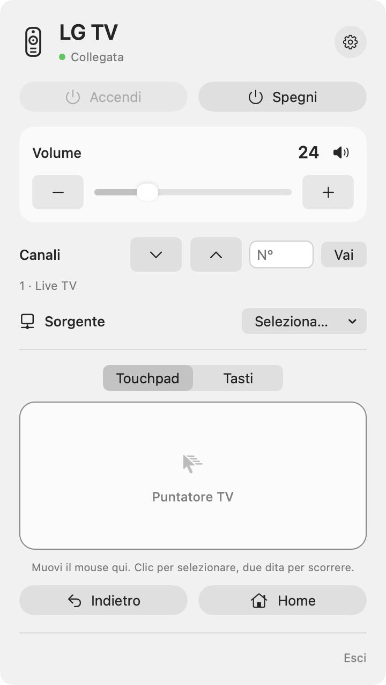
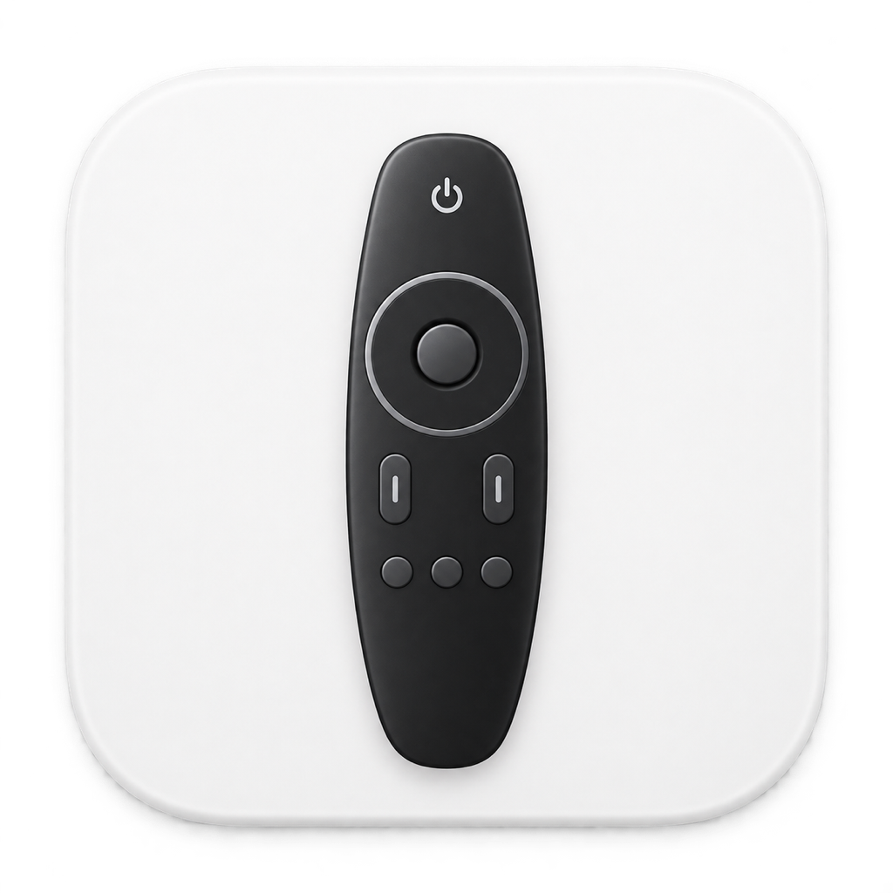
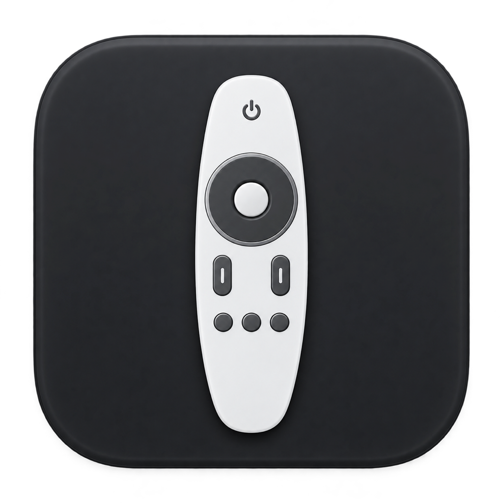

# Telecomando LG per macOS

Italiano · [English](README.md)

Una piccola app nativa nella barra dei menu del Mac per controllare una TV LG webOS sulla rete locale.

L’ho creata per mia comodità: volevo regolare il volume, cambiare canale o sorgente e navigare sulla TV senza cercare ogni volta il telecomando. Mi è tornata utile e mi fa piacere condividerla con chi potrebbe avere la stessa esigenza.

**Progetto personale di Giulio Schiavo. Testato su LG 55UM7450PLA. La compatibilità con tutti i televisori LG webOS non è garantita.**

## Anteprima



Interfaccia italiana con dati dimostrativi.

### Icone dell’app

| Chiara | Scura |
| --- | --- |
|  |  |

## Funzioni

- Telecomando nella barra dei menu, con aspetto chiaro/scuro di sistema.
- Volume con cursore e pulsanti, audio disattivato/riattivato.
- Canale precedente/successivo e inserimento del numero per il sintonizzatore della TV.
- Sorgenti, Home, Indietro, frecce direzionali e OK.
- Spegnimento; accensione Wake-on-LAN quando supportata e configurata.
- Touchpad opzionale per il puntatore via rete: movimento, clic, scorrimento e clic destro per tornare indietro.
- Quattro livelli di velocità. Disattivando **Puntatore Magic Remote** nelle impostazioni rimangono i tasti.
- Associazione conservata nel Portachiavi di macOS.
- Interfaccia italiana e inglese secondo la lingua dell’app scelta da macOS: **Telecomando LG** / **LG Remote**.

## Requisiti e compatibilità

- Mac con Apple Silicon e macOS 13 o successivo. La compilazione attuale è arm64; non sono distribuite versioni Intel.
- TV LG webOS con controllo remoto via rete disponibile.
- Mac e TV sulla stessa rete locale, senza isolamento dei dispositivi o rete ospiti.
- Conferma della richiesta di associazione sul televisore al primo collegamento.

L’implementazione attuale usa `ws://<TV>:3000`. Il collegamento cifrato `wss://` sulla porta 3001 non è ancora implementato: una TV che accetta solo quello non potrà collegarsi con questa versione.

**Modello testato:** LG 55UM7450PLA. L’autore ha provato i comandi base e il puntatore relativo. Il Wake-on-LAN è implementato, ma va verificato sul singolo televisore e sulla rete utilizzata. Non viene dichiarata una certificazione di compatibilità più ampia.

Il puntatore dipende dal servizio di input via rete della TV e dai suoi permessi. Non è necessario possedere un Magic Remote fisico per usare l’app; la compatibilità con quel telecomando non dimostra però quella del puntatore via rete. Se il puntatore non funziona, disattivalo nelle impostazioni e prova le frecce. Alcune TV possono limitare anche quei tasti, perché usano il servizio di input di rete.

Sono fuori dall’ambito supportato le TV LG NetCast, le TV senza webOS e i decoder HDMI esterni. I comandi dei canali agiscono sul sintonizzatore della TV. Alcune app della TV possono non offrire interazioni con il puntatore.

## Installazione

Scarica [Telecomando LG 1.0 per Apple Silicon](https://github.com/giulioschiavo/lg-remote-for-macos/releases/download/v1.0/LG-Remote-1.0-macOS-arm64.zip) dalla [Release v1.0](https://github.com/giulioschiavo/lg-remote-for-macos/releases/tag/v1.0), estrai l’app e sposta **Telecomando LG.app** in Applicazioni. Il nome visualizzato segue la lingua dell’app.

Le compilazioni locali attuali hanno firma ad-hoc: **non sono firmate con Developer ID né notarizzate**. macOS può mostrare un avviso sullo sviluppatore non verificato. Se preferisci esaminare e compilare il codice, usa i sorgenti. Firma Developer ID e notarizzazione sono previste per semplificare la distribuzione.

## Primo collegamento

1. Accendi la TV e apri l’app da Applicazioni.
2. Nelle impostazioni inserisci il nome di rete o l’indirizzo IPv4 della TV. Il valore iniziale è `LGwebOSTV.local`, ma sulla tua rete potrebbe essere diverso.
3. Premi **Salva e collega** e accetta la richiesta sulla TV.
4. Consenti l’accesso alla rete locale se macOS lo richiede.

L’associazione viene salvata nel Portachiavi: normalmente basta una sola conferma. Ripristino della TV, revoca dei permessi o ampliamento dei permessi possono richiedere una nuova associazione. In quel caso usa **Nuova associazione** nelle impostazioni.

Un clic sull’icona nella barra apre o nasconde il pannello. Anche Escape e un clic esterno lo nascondono.

## Touchpad

Muovi il cursore del Mac all’interno per spostare in modo relativo il puntatore della TV. Clic per selezionare, due dita o rotella per scorrere, clic destro per tornare indietro. Fuori dall’area il movimento si interrompe; al rientro continua dalla posizione attuale sulla TV.

Il touchpad **non fa corrispondere i suoi bordi allo schermo**, non sposta automaticamente il cursore del Mac e non ricentra il puntatore della TV. La TV può modificare la distanza percorsa in base alla velocità. Puoi regolare la velocità nelle impostazioni oppure disabilitare il puntatore e usare i tasti.

## Accensione Wake-on-LAN

### Dove trovare il MAC della TV

Con la TV accesa, apri **Impostazioni → Tutte le impostazioni**. I percorsi più comuni sono:

- **webOS 4.5 (2019):** Generali → Informazioni sulla TV → Informazioni TV.
- **webOS 5.0 (2020) e webOS 23 o successivo:** Sostegno / Supporto → Informazioni TV.
- **webOS 6.0 / 22 (2021–2022):** Generali → Dispositivi → Gestione TV → Informazioni TV.

Copia il MAC della connessione utilizzata: Wi-Fi ed Ethernet hanno indirizzi diversi. Se cambi tipo di collegamento, aggiorna il MAC nell’app. In alternativa, cerca la TV nell’elenco dei dispositivi collegati al router. Quando il campo è vuoto, dopo il collegamento l’app prova anche a recuperare il MAC della scheda attiva; se non compare, inseriscilo manualmente. Le voci possono cambiare secondo modello e firmware: consulta la [guida LG al MAC della TV](https://www.lg.com/us/support/help-library/how-to-find-the-mac-address-on-your-lg-tv-CT10000018-20155444682287).

### Abilitare l’accensione dallo standby

Nelle versioni webOS meno recenti cerca **Tutte le impostazioni → Generali → Mobile TV attivo**. In quelle più recenti cerca in **Generali → Dispositivi → Dispositivi esterni → Accendi TV con dispositivo mobile**. Abilita **Attiva tramite Wi-Fi**, se disponibile: la sola opzione Bluetooth non basta per questa app. Se la voce è diversa o assente, consulta il manuale del tuo modello. LG descrive la funzione nel [manuale webOS](https://kr.eguide.lgappstv.com/manual/w25/w25_us21/enga.html).

Lascia la TV alimentata e collegata alla rete anche in standby. Il Mac deve essere sulla stessa rete locale. Poi configura l’app:

1. Sulla TV abilita **Mobile TV attivo / Accendi TV con dispositivo mobile → Attiva tramite Wi-Fi**, se disponibile. Nomi e percorso cambiano tra versioni webOS.
2. Nelle impostazioni dell’app inserisci il MAC della scheda Wi-Fi o Ethernet utilizzata dalla TV. Non usare l’identificativo AirPlay.
3. Imposta il broadcast della sottorete. `192.168.1.255` è adatto solo a una rete `192.168.1.x` con maschera `255.255.255.0`.
4. Salva, metti la TV in standby e prova **Accendi**.

La TV deve restare alimentata e la sua rete deve supportare il risveglio dallo standby. L’app invia un pacchetto Wake-on-LAN locale: non offre accensione via internet e l’invio non garantisce che la TV si sia accesa.

## Privacy

Comandi TV e Wake-on-LAN restano sulla rete locale. Non ci sono statistiche d’uso, pubblicità, account cloud o strumenti di tracciamento. Le chiavi di associazione sono nel Portachiavi; indirizzo TV, accensione e velocità sono nelle preferenze locali di macOS. Nessuna chiave è incorporata nell’app o nel repository.

La versione 1.0 include un controllo facoltativo, disattivato in modo predefinito, tramite GitHub Releases: parte all’avvio e poi ogni 24 ore mentre l’app resta aperta. Il controllo manuale è sempre disponibile. Quando c’è una release disponibile, l’app mostra un banner interno e, se macOS ha concesso il permesso, una notifica nativa. L’apertura del link alla release resta manuale: l’app non installa né scarica mai aggiornamenti automaticamente. Le richieste internet vanno solo a GitHub quando il controllo è stato attivato dall’utente o avviato manualmente. Non ci sono statistiche d’uso né richieste di tracciamento.

## Compilazione dai sorgenti

Installa gli strumenti Apple da riga di comando e usa un compilatore Swift compatibile:

```sh
xcode-select --install
cd LGRemote
./build.command
./dist/Telecomando\ LG.app/Contents/MacOS/LGRemote --self-test
open "dist/Telecomando LG.app"
```

L’app usa SwiftUI, AppKit, Foundation e Security. Per compilarla non servono Node.js, Python o pacchetti di terze parti. Python serve solo allo script facoltativo per ricostruire le icone. Lo script produce un’app arm64 con firma ad-hoc e non installa servizi in background.

Le immagini PNG/ICNS includono icone chiare e scure. L’icona della barra è un modello monocromatico. Non vengono dichiarate varianti automatiche dell’icona nel Finder; l’icona dell’app in esecuzione segue l’aspetto di sistema.

## Segnalazioni e contributi

Sono benvenuti segnalazioni, pull request e test su altri modelli. Indica modello TV, versione webOS/firmware, versione macOS, versione dell’app e comandi provati. Non pubblicare chiavi di associazione, dettagli privati della rete o log completi senza oscurare i dati personali.

Vedi [CONTRIBUTING.md](CONTRIBUTING.md) e [CHANGELOG.md](CHANGELOG.md). È un progetto sviluppato nel tempo libero: assistenza e aggiornamenti dipendono dal tempo disponibile.

## Sviluppi previsti

- Test su altri modelli reali.
- Collegamento WebSocket cifrato e ricerca delle TV sulla rete.
- Firma Developer ID, notarizzazione ed eventuali versioni Intel.

## Licenza e crediti

[Licenza MIT](LICENSE). Creato da **Giulio Schiavo**, con sviluppo assistito dall’AI.

Progetto indipendente e non ufficiale, non affiliato, approvato o supportato da LG Electronics. LG, webOS e Magic Remote sono marchi dei rispettivi titolari.
