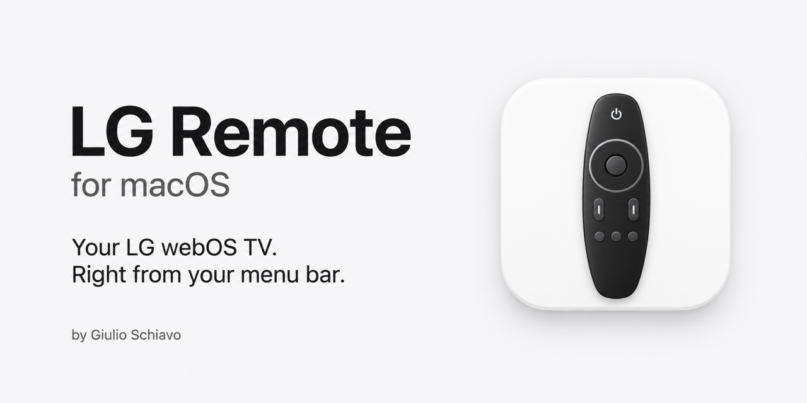
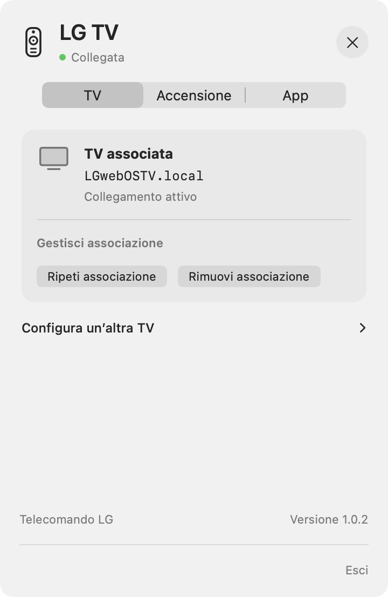
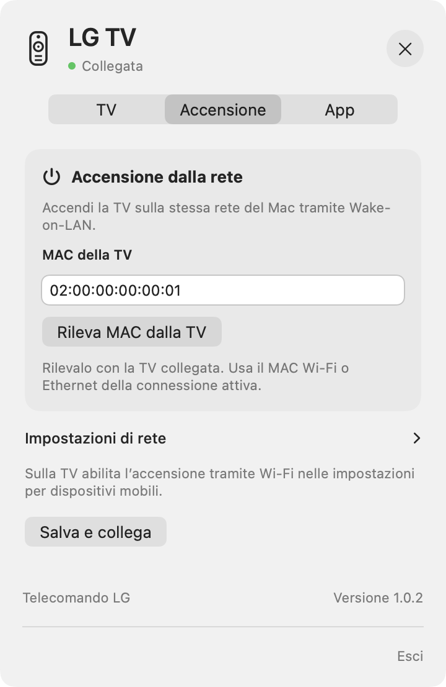
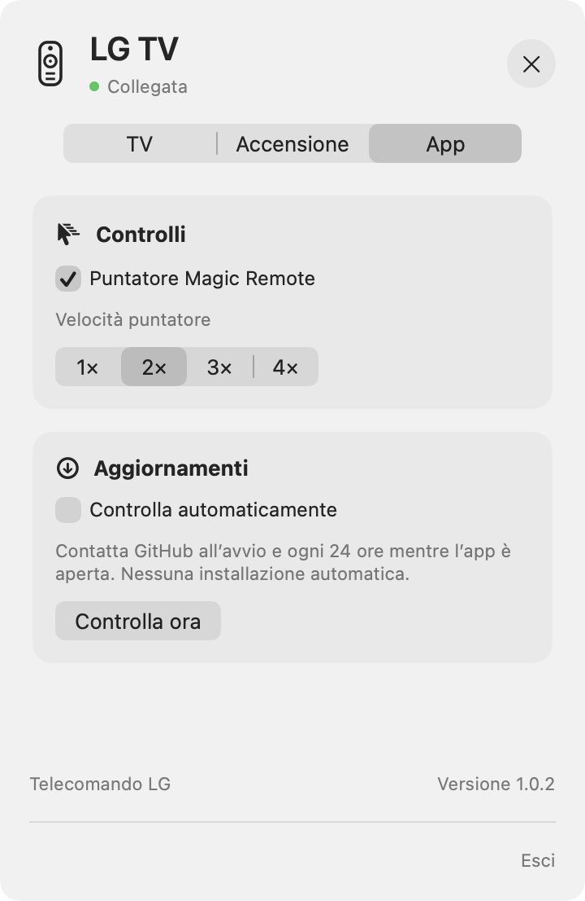

# Telecomando LG per macOS

Italiano · [English](README.md)

Una piccola app nativa nella barra dei menu del Mac per controllare una TV LG webOS sulla rete locale.

L’ho creata per mia comodità: volevo regolare il volume, cambiare canale o sorgente e navigare sulla TV senza cercare ogni volta il telecomando. Mi è tornata utile e mi fa piacere condividerla con chi potrebbe avere la stessa esigenza.

**Progetto personale di Giulio Schiavo. Testato su LG 55UM7450PLA. La compatibilità con tutti i televisori LG webOS non è garantita.**

## Anteprima


Interfaccia italiana con dati dimostrativi.

### Impostazioni

Le tre schede delle impostazioni, con dati dimostrativi.

| TV | Accensione | App |
| --- | --- | --- |
|  |  |  |

### Icone dell’app

| Chiara | Scura |
| --- | --- |
|  |  |

## Funzioni

- Telecomando nella barra dei menu, con aspetto chiaro/scuro di sistema.
- Volume con cursore e pulsanti, audio disattivato/riattivato.
- Canale precedente/successivo e inserimento del numero per il sintonizzatore della TV.
- Sorgenti, Home, Indietro, frecce direzionali e OK.
- Spegnimento; accensione Wake-on-LAN quando supportata e configurata.
- Touchpad opzionale per il puntatore via rete: movimento, clic, scorrimento e clic destro per tornare indietro.
- Quattro livelli di velocità. Disattivando **Puntatore Magic Remote** nelle impostazioni rimangono i tasti.
- Associazione conservata nel Portachiavi di macOS.
- Interfaccia italiana e inglese secondo la lingua dell’app scelta da macOS: **Telecomando LG** / **LG Remote**.

## Requisiti e compatibilità

- Mac con Apple Silicon e macOS 13 o successivo. La compilazione attuale è arm64; non sono distribuite versioni Intel.
- TV LG webOS con controllo remoto via rete disponibile.
- Mac e TV sulla stessa rete locale, senza isolamento dei dispositivi o rete ospiti.
- Conferma della richiesta di associazione sul televisore al primo collegamento.

L’app preferisce il collegamento cifrato `wss://<TV>:3001`. Al primo utilizzo approva il certificato solo se riconosci la TV sulla tua rete: l’impronta SHA-256 viene salvata nel Portachiavi. Un certificato cambiato o rifiutato blocca il collegamento sicuro. Il ripiego su `ws://<TV>:3000` avviene soltanto se la porta sicura rifiuta la connessione e non esiste già un certificato approvato. Errori di certificato, TLS o timeout non provocano il ripiego. Lo stato del collegamento indica il trasporto utilizzato.

**Modello testato:** LG 55UM7450PLA. L’autore ha provato i comandi base e il puntatore relativo. Il Wake-on-LAN è implementato, ma va verificato sul singolo televisore e sulla rete utilizzata. Non viene dichiarata una certificazione di compatibilità più ampia.

Il puntatore dipende dal servizio di input via rete della TV e dai suoi permessi. Non è necessario possedere un Magic Remote fisico per usare l’app; la compatibilità con quel telecomando non dimostra però quella del puntatore via rete. Se il puntatore non funziona, disattivalo nelle impostazioni e prova le frecce. Alcune TV possono limitare anche quei tasti, perché usano il servizio di input di rete.

Sono fuori dall’ambito supportato le TV LG NetCast, le TV senza webOS e i decoder HDMI esterni. I comandi dei canali agiscono sul sintonizzatore della TV. Alcune app della TV possono non offrire interazioni con il puntatore.

## Installazione

Scarica [Telecomando LG 1.0.2 per Apple Silicon](https://github.com/giulioschiavo/lg-remote-for-macos/releases/download/v1.0.2/LG-Remote-1.0.2-macOS-arm64.zip) dalla [Release v1.0.2](https://github.com/giulioschiavo/lg-remote-for-macos/releases/tag/v1.0.2), estrai l’app e sposta **Telecomando LG.app** in Applicazioni. Il nome visualizzato segue la lingua dell’app.

Le compilazioni locali attuali hanno firma ad-hoc: **non sono firmate con Developer ID né notarizzate**. macOS può mostrare un avviso sullo sviluppatore non verificato. Se preferisci esaminare e compilare il codice, usa i sorgenti. Firma Developer ID e notarizzazione sono previste per semplificare la distribuzione.

## Primo collegamento

1. Accendi la TV e apri l’app da Applicazioni.
2. In Impostazioni → TV premi **Cerca TV**, seleziona il televisore e premi **Collega**.
3. Accetta la richiesta sulla TV e consenti l’accesso alla rete locale se macOS lo richiede.

Se la ricerca non è disponibile, apri **Inserisci indirizzo manualmente** e indica il nome di rete o l’indirizzo IPv4. La ricerca richiede una TV accesa e visibile sulla stessa rete locale.

L’associazione viene salvata nel Portachiavi. **Ripeti associazione** richiede una nuova approvazione e conserva la chiave precedente fino al completamento. **Rimuovi associazione** chiede conferma e cancella il collegamento TV e le impostazioni di accensione salvate.

Per le TV selezionate tramite ricerca, l’app ricorda anche l’identità del dispositivo. Se all’avvio dell’app l’IP salvato non risponde, esegue una sola ricerca locale limitata per ritrovare quella TV e aggiorna l’IP quando il risultato è univoco. Per le associazioni manuali già esistenti, seleziona una volta la TV tramite **Cerca TV** per memorizzarne l’identità. I comandi continuano a usare l’IP: il MAC serve al Wake-on-LAN. Non ci sono scansioni periodiche della TV, servizi al login o processi ausiliari in background.

Le impostazioni sono divise nelle schede **TV**, **Accensione** e **App**. La scheda TV mostra prima il televisore associato e separa **Configura un’altra TV** dalla gestione dell’associazione. **Ricollega** è disponibile qui quando scollegata e richiede una TV già accesa. Usa **Accendi** nel telecomando per risvegliarla e ricollegarti automaticamente. Il broadcast è in **Impostazioni di rete** nella scheda Accensione.

Un clic sull’icona nella barra apre o nasconde il pannello. Anche Escape e un clic esterno lo nascondono.

### Consiglio: mantieni stabile l’indirizzo IP della TV

Per rendere più stabile il collegamento tra app e TV, consigliamo di assegnare al televisore sempre lo stesso IP sulla rete locale. Il metodo preferibile è una **prenotazione DHCP sul router**, spesso chiamata *IP riservato*, *associazione IP/MAC* o *Address Reservation*: il router assegna sempre lo stesso indirizzo al MAC della scheda Wi-Fi o Ethernet utilizzata dalla TV, mentre sul televisore puoi lasciare la configurazione automatica.

Cerca la TV nell’elenco dei dispositivi del router e riservale un indirizzo nella tua sottorete, seguendo le istruzioni del produttore. Wi-Fi ed Ethernet hanno MAC diversi: se cambi tipo di collegamento, aggiorna la prenotazione. Un [esempio ufficiale TP-Link](https://www.tp-link.com/us/support/faq/182/) illustra il principio; nomi e percorsi variano secondo il router.

In alternativa puoi configurare un IP statico direttamente sulla TV, usando indirizzo, maschera, gateway e DNS corretti e un indirizzo escluso dal pool DHCP o riservato sul router, per evitare conflitti. La prenotazione DHCP è in genere più semplice da gestire.

Un IP stabile evita cambi d’indirizzo; non rende permanente l’autorizzazione della TV e non garantisce l’accensione dallo standby. Restano necessari l’associazione approvata e il corretto MAC per Wake-on-LAN.

## Touchpad

Muovi il cursore del Mac all’interno per spostare in modo relativo il puntatore della TV. Clic per selezionare, due dita o rotella per scorrere, clic destro per tornare indietro. Fuori dall’area il movimento si interrompe; al rientro continua dalla posizione attuale sulla TV.

Il touchpad **non fa corrispondere i suoi bordi allo schermo**, non sposta automaticamente il cursore del Mac e non ricentra il puntatore della TV. La TV può modificare la distanza percorsa in base alla velocità. Puoi regolare la velocità nelle impostazioni oppure disabilitare il puntatore e usare i tasti.

## Accensione Wake-on-LAN

### Dove trovare il MAC della TV

Con la TV accesa, apri **Impostazioni → Tutte le impostazioni**. I percorsi più comuni sono:

- **webOS 4.5 (2019):** Generali → Informazioni sulla TV → Informazioni TV.
- **webOS 5.0 (2020) e webOS 23 o successivo:** Sostegno / Supporto → Informazioni TV.
- **webOS 6.0 / 22 (2021–2022):** Generali → Dispositivi → Gestione TV → Informazioni TV.

Copia il MAC della connessione utilizzata: Wi-Fi ed Ethernet hanno indirizzi diversi. Se cambi tipo di collegamento, aggiorna il MAC nell’app. In alternativa, cerca la TV nell’elenco dei dispositivi collegati al router. In Impostazioni → Accensione premi **Rileva MAC dalla TV**. Se la TV conferma una sola scheda attiva e il campo è vuoto, il MAC può essere impostato automaticamente. Se restituisce più schede o non indica quella attiva, scegli il candidato Wi-Fi o Ethernet corretto con **Usa questo MAC**. I valori già salvati vengono conservati; resta disponibile l’inserimento manuale. L’app può anche proporre un valore dalla cache ARP locale, da confermare. Le voci possono cambiare secondo modello e firmware: consulta la [guida LG al MAC della TV](https://www.lg.com/us/support/help-library/how-to-find-the-mac-address-on-your-lg-tv-CT10000018-20155444682287).

### Abilitare l’accensione dallo standby

Nelle versioni webOS meno recenti cerca **Tutte le impostazioni → Generali → Mobile TV attivo**. In quelle più recenti cerca in **Generali → Dispositivi → Dispositivi esterni → Accendi TV con dispositivo mobile**. Abilita **Attiva tramite Wi-Fi**, se disponibile: la sola opzione Bluetooth non basta per questa app. Se la voce è diversa o assente, consulta il manuale del tuo modello. LG descrive la funzione nel [manuale webOS](https://kr.eguide.lgappstv.com/manual/w25/w25_us21/enga.html).

Lascia la TV alimentata e collegata alla rete anche in standby. Il Mac deve essere sulla stessa rete locale. Poi configura l’app:

1. Sulla TV abilita **Mobile TV attivo / Accendi TV con dispositivo mobile → Attiva tramite Wi-Fi**, se disponibile. Nomi e percorso cambiano tra versioni webOS.
2. In Impostazioni → Accensione rileva o inserisci il MAC della scheda utilizzata dalla TV. Non usare l’identificativo AirPlay.
3. Verifica il broadcast, calcolato automaticamente quando la sottorete locale è univoca; inseriscilo manualmente se necessario. `192.168.1.255` è adatto solo a una rete `192.168.1.x` con maschera `255.255.255.0`.
4. Salva, metti la TV in standby e prova **Accendi**.

Accendi invia cinque pacchetti Wake-on-LAN a intervalli di 300 ms, poi tenta il ricollegamento. L’app controlla la connessione esistente e ascolta gli eventi di alimentazione della TV; una TV non raggiungibile non viene automaticamente considerata spenta.

La TV deve restare alimentata e la sua rete deve supportare il risveglio dallo standby. L’app invia un pacchetto Wake-on-LAN locale: non offre accensione via internet e l’invio non garantisce che la TV si sia accesa.

### Se l’accensione smette di funzionare dopo un po’ in standby

Se la TV si accende da remoto subito dopo lo spegnimento, ma non dopo un’attesa più lunga, la connessione di rete potrebbe diventare indisponibile durante lo standby. Disattivare il risparmio energetico, da solo, non permette di stabilire se l’accensione via rete resti disponibile.

Con una connessione Wi-Fi, controlla prima **Mobile TV attivo / Accendi TV con dispositivo mobile → Attiva tramite Wi-Fi**. Prova anche ad attivare **Quick Start+ / Avvio rapido+**, se il modello lo prevede, e ripeti la prova. Quick Start+ modifica lo standby per consentire un avvio più rapido: è una verifica da fare, non una garanzia di accensione via rete. Nomi e percorsi cambiano secondo modello e firmware: consulta la [guida LG a Quick Start+](https://www.lg.com/uk/support/product-support/troubleshoot/help-library/cs-CT00008333-20153130708672OLT/).

Spegni normalmente la TV, lasciala alimentata e prova ad accenderla dopo un minuto e poi dopo 30–60 minuti. Se non funziona, prova nello stesso momento anche con LG ThinQ da un telefono collegato allo stesso Wi-Fi. Se falliscono entrambi, verifica standby, impostazioni di rete della TV e rete locale prima di attribuire il problema soltanto all’app. Se la scheda di rete della TV non è più in ascolto, questa app non può forzarla a ricevere il pacchetto Wake-on-LAN.

## Privacy

Ricerca TV, comandi e Wake-on-LAN restano sulla rete locale. Non ci sono statistiche d’uso, pubblicità, account cloud o strumenti di tracciamento. Le chiavi di associazione e le impronte dei certificati approvati sono nel Portachiavi; indirizzo e identità TV, accensione e velocità sono nelle preferenze locali di macOS. Nessuna chiave è incorporata nell’app o nel repository.

L’app include un controllo facoltativo, disattivato in modo predefinito, tramite GitHub Releases: parte all’avvio e poi ogni 24 ore mentre l’app resta aperta. Il controllo manuale è sempre disponibile. Quando c’è una release disponibile, l’app mostra un banner interno e, se macOS ha concesso il permesso, una notifica nativa. L’apertura del link alla release resta manuale: l’app non installa né scarica mai aggiornamenti automaticamente. Le richieste internet vanno solo a GitHub quando il controllo è stato attivato dall’utente o avviato manualmente. Non ci sono statistiche d’uso né richieste di tracciamento.

## Compilazione dai sorgenti

Installa gli strumenti Apple da riga di comando e usa un compilatore Swift compatibile:

```sh
xcode-select --install
cd LGRemote
./build.command
./dist/Telecomando\ LG.app/Contents/MacOS/LGRemote --self-test
open "dist/Telecomando LG.app"
```

L’app usa SwiftUI, AppKit, Foundation, Security e UserNotifications. Per compilarla non servono Node.js, Python o pacchetti di terze parti. Python serve solo allo script facoltativo per ricostruire le icone. Lo script produce un’app arm64 con firma ad-hoc e non installa servizi in background.

Le immagini PNG/ICNS includono icone chiare e scure. L’icona della barra è un modello monocromatico. Non vengono dichiarate varianti automatiche dell’icona nel Finder; l’icona dell’app in esecuzione segue l’aspetto di sistema.

## Segnalazioni e contributi

Sono benvenuti segnalazioni, pull request e test su altri modelli. Indica modello TV, versione webOS/firmware, versione macOS, versione dell’app e comandi provati. Non pubblicare chiavi di associazione, dettagli privati della rete o log completi senza oscurare i dati personali.

Vedi [CONTRIBUTING.md](CONTRIBUTING.md) e [CHANGELOG.md](CHANGELOG.md). È un progetto sviluppato nel tempo libero: assistenza e aggiornamenti dipendono dal tempo disponibile.

## Sviluppi previsti

- Test su altri modelli reali.
- Test su altre reti e sul risveglio dopo standby prolungato.
- Firma Developer ID, notarizzazione ed eventuali versioni Intel.

## Licenza e crediti

[Licenza MIT](LICENSE). Creato da **Giulio Schiavo**, con sviluppo assistito dall’AI.

Progetto indipendente e non ufficiale, non affiliato, approvato o supportato da LG Electronics. LG, webOS e Magic Remote sono marchi dei rispettivi titolari.
