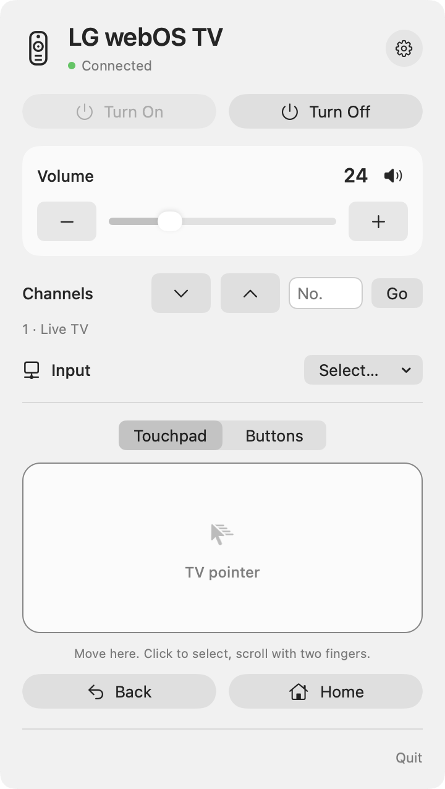
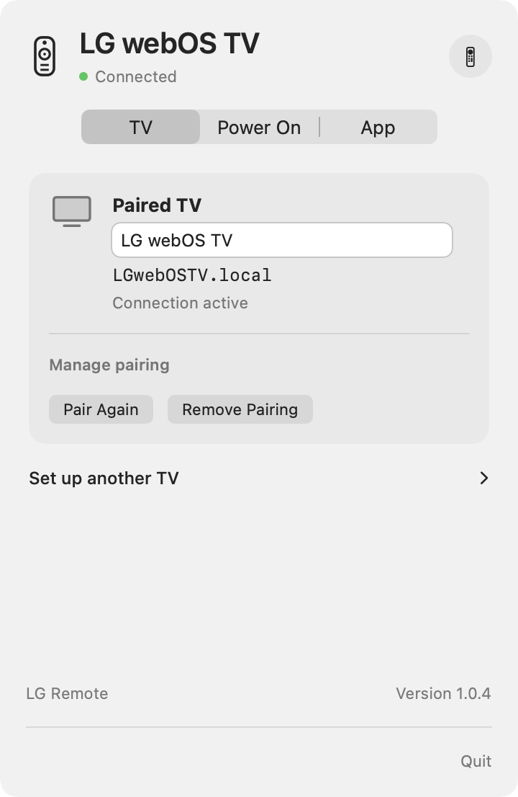
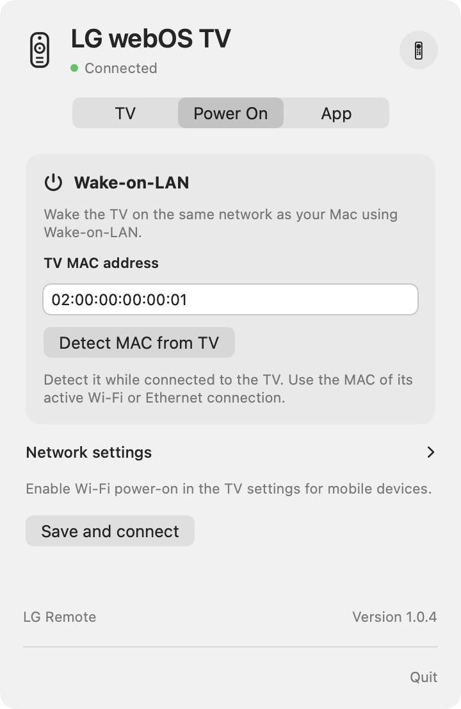
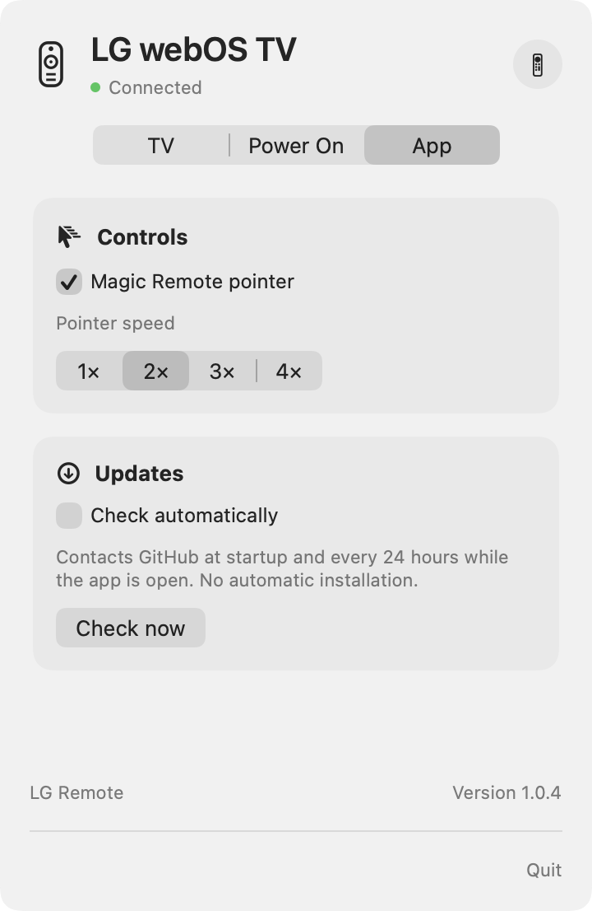

# LG Remote for macOS

[Italiano](README.it.md) · English

A small native macOS menu bar app to control an LG webOS TV on your local network.

I built this app for my own convenience: I wanted to adjust the volume, change channels and inputs, and navigate my TV without reaching for the remote. It turned out useful, so I’m happy to share it with anyone who might enjoy the same setup.

**Personal project by Giulio Schiavo. Tested on an LG 55UM7450PLA. Compatibility with every LG webOS TV is not guaranteed.**

## Preview



English interface with sample data.

### Settings

The three settings tabs, shown with sample data.

| TV | Power On | App |
| --- | --- | --- |
|  |  |  |

### App icons

| Light | Dark |
| --- | --- |
|  |  |

## Features

- Menu bar remote with system light and dark appearance.
- Volume slider, volume buttons and mute.
- Previous/next channel and channel number entry for the TV tuner.
- Input selection, Home, Back, directional buttons and OK.
- Power off; Wake-on-LAN power on when supported and configured.
- Optional touchpad for the TV’s network pointer: move, click, scroll and right-click to go back.
- Four pointer speed levels. Disable **Magic Remote pointer** in Settings to use buttons only.
- Persistent pairing through macOS Keychain.
- English and Italian interface, following the app language selected by macOS: **LG Remote** / **Telecomando LG**.

## Requirements and compatibility

- A Mac with Apple Silicon and macOS 13 or later. The current build is arm64; Intel builds are not provided.
- An LG webOS TV with local network remote control available.
- Mac and TV on the same local network, without guest-network/client isolation.
- Approval of the pairing request on the TV at first connection.

The app prefers encrypted `wss://<TV>:3001`. At first use, approve the TV certificate only if you recognize the device on your network; its SHA-256 fingerprint is stored in Keychain. A changed or rejected certificate blocks the secure connection. Legacy `ws://<TV>:3000` is tried only when the secure endpoint refuses the connection and no certificate has already been approved. Certificate, TLS and timeout errors do not trigger a downgrade. The connection status shows the transport in use.

**Tested TV:** LG 55UM7450PLA. Basic remote commands and relative pointer movement were tested by the author. Wake-on-LAN is implemented but should be verified for your particular TV and network. No broader compatibility certification is claimed.

Pointer support depends on the TV’s network input service and permissions. Owning a physical Magic Remote is not an app requirement, and physical remote compatibility does not prove network pointer compatibility. If pointer control is unavailable, switch it off in Settings and try the directional buttons. Some TVs may also restrict those buttons because they use the network input service.

LG NetCast TVs, non-webOS TVs and external HDMI set-top boxes are outside the supported scope. Channel commands address the TV tuner, not an attached decoder. Some TV apps may not expose pointer interactions.

## Installation

Download [LG Remote 1.0.4 for Apple Silicon](https://github.com/giulioschiavo/lg-remote-for-macos/releases/download/v1.0.4/LG-Remote-1.0.4-macOS-arm64.zip) from [Release v1.0.4](https://github.com/giulioschiavo/lg-remote-for-macos/releases/tag/v1.0.4), extract the app and move **Telecomando LG.app** to Applications. Its displayed name follows your app language.

Current locally packaged builds are ad-hoc signed, **not Developer ID signed or notarized**. macOS may display an unverified-developer warning. Build from source if you prefer to inspect and compile the code. Developer ID signing and notarization are planned for easier distribution.

## First connection

1. Turn on the TV and open the app from Applications.
2. In Settings → TV, choose **Find TV**, select your TV and choose **Connect**.
3. Approve the pairing request on the TV and allow local network access if macOS asks.

If discovery is unavailable, expand **Enter address manually** and enter the hostname or IPv4 address. Discovery requires the TV to be awake and visible on the same local network.

Pairing is stored in Keychain. **Pair Again** requests a new approval while preserving the previous key until success. **Remove Pairing** asks for confirmation and clears the saved TV connection and wake settings.

For TVs selected through discovery, the app remembers their device identity. If the saved IP fails at app startup, it performs one bounded local search for that same TV and updates its IP when the match is unambiguous. Existing manual associations can obtain this identity by selecting the TV through **Find TV** once. This does not replace the IP used for commands: the MAC is used for Wake-on-LAN. There is no periodic TV scan, login service or background helper.

Settings are divided into **TV**, **Power On** and **App** tabs. The TV tab puts the paired TV first, with **Set up another TV** separate from pairing management. Reconnect is available here when disconnected; it does not wake the TV. Use **Turn On** in the remote to wake and reconnect automatically. Broadcast configuration is under **Network settings** in Power On.

Click the menu bar icon to open or hide the panel. Escape and clicking outside also hide it.

### Tip: keep the TV’s IP address stable

For a more consistent connection between the app and TV, we recommend giving the TV the same IP address on your local network. Prefer a **DHCP reservation on your router**, also called *reserved IP*, *IP/MAC binding* or *Address Reservation*: the router assigns the same address to the MAC of the TV’s active Wi-Fi or Ethernet adapter, while the TV can keep its automatic network configuration.

Find the TV in the router’s device list and reserve an address in your subnet, following the router manufacturer’s instructions. Wi-Fi and Ethernet have different MAC addresses; update the reservation if you change connection type. This [official TP-Link example](https://www.tp-link.com/us/support/faq/182/) illustrates the principle; menu names and paths vary by router.

Alternatively, configure a static IP on the TV with the correct address, subnet mask, gateway and DNS, using an address excluded from the DHCP pool or reserved on the router to avoid conflicts. A DHCP reservation is usually easier to manage.

A stable IP prevents address changes; it does not make TV authorization permanent or guarantee wake from standby. Approved pairing and the correct Wake-on-LAN MAC are still required.

## Touchpad

Move the Mac cursor inside the touchpad to move the TV pointer relatively. Click to select, scroll with two fingers or a mouse wheel, and right-click to go back. Movement stops outside the touchpad; reenter to continue from the TV pointer’s current position.

The touchpad **does not map its edges to the screen**, warp the Mac cursor or automatically center the TV pointer. The TV can apply speed-dependent movement, so travel distance can vary. Change pointer speed in Settings, or disable the pointer and use buttons.

## Wake-on-LAN

### Finding the TV’s MAC address

With the TV on, open **Settings → All Settings**. Common paths are:

- **webOS 4.5 (2019):** General → About This TV → TV Information.
- **webOS 5.0 (2020) and webOS 23 or later:** Support → TV Information.
- **webOS 6.0 / 22 (2021–2022):** General → Devices → TV Management → TV Information.

Copy the address for the connection in use: Wi-Fi and Ethernet have different MAC addresses. If you change connection type, update the app’s MAC setting. As an alternative, check your router’s connected-device list and identify the TV. In Settings → Power On, use **Detect MAC from TV**. A single confirmed-active adapter can fill an empty MAC field automatically. If the TV returns several adapters or does not identify the active one, select the matching Wi-Fi or Ethernet candidate with **Use This MAC**. Saved values are preserved; manual entry remains available. The app may also suggest a value from the local ARP cache for you to confirm. Menu names vary by model and firmware; see [LG’s MAC address guide](https://www.lg.com/us/support/help-library/how-to-find-the-mac-address-on-your-lg-tv-CT10000018-20155444682287).

### Enabling wake from standby

On older webOS versions, look in **All Settings → General → Mobile TV On**. On newer versions, look under **General → Devices → External Devices → TV On With Mobile**. Enable **Turn on via Wi-Fi**, if available; a Bluetooth-only setting is insufficient for this app. Consult your model’s manual if the setting is elsewhere or absent. LG describes the option in its [webOS user guide](https://kr.eguide.lgappstv.com/manual/w25/w25_us21/enga.html).

Keep the TV plugged in and connected to the network while in standby. Keep the Mac on the same local network. Then configure the app:

1. On the TV, enable **Mobile TV On / TV On With Mobile → Turn on via Wi-Fi**, if available. Labels and paths vary with webOS version.
2. Detect or enter the MAC of the active adapter in Settings → Power On. Do not use its AirPlay device identifier.
3. Review the broadcast address, calculated automatically when the local subnet is unambiguous; enter it manually if needed. `192.168.1.255` is only appropriate for a `192.168.1.x` network with a `255.255.255.0` mask.
4. Save, put the TV in standby and try **Turn On**.

Turn On sends five Wake-on-LAN packets at 300 ms intervals, then attempts to reconnect. The app monitors the existing connection and TV power-state events; an unreachable TV is not assumed to be powered off.

The TV must stay powered and its network hardware must support wake from standby. The app sends a local Wake-on-LAN packet; it does not offer wake over the internet, and sending a packet does not guarantee the TV has turned on.

### If power-on stops working after a while in standby

If the TV wakes shortly after being turned off but no longer responds after a longer wait, its network connection may become unavailable during standby. Disabling energy saving alone does not establish whether network wake remains available.

With a Wi-Fi connection, first check **Mobile TV On / TV On With Mobile → Turn on via Wi-Fi**. Also try enabling **Quick Start+**, if your model offers it, then repeat the test. Quick Start+ changes standby behavior to allow a faster startup; it is a troubleshooting step, not a guarantee that network wake will work. Menu names and paths vary by model and firmware: see [LG’s Quick Start+ guide](https://www.lg.com/uk/support/product-support/troubleshoot/help-library/cs-CT00008333-20153130708672OLT/).

Turn the TV off normally, leave it plugged in, and test power-on after one minute and again after 30–60 minutes. If it fails, also try LG ThinQ on a phone connected to the same Wi-Fi at that time. If both fail, investigate the TV’s standby/network settings and the network rather than assuming an app-only fault. If the TV’s network adapter is no longer listening, this app cannot force it to receive a Wake-on-LAN packet.

## Privacy

TV discovery, commands and Wake-on-LAN traffic stay on the local network. The app has no analytics, ads, cloud account or tracking SDK. Pairing keys and approved certificate fingerprints are stored in Keychain; TV address and device identity, wake settings and pointer preferences use local macOS preferences. Keys are not embedded in the app or repository.

The app includes a default-off, opt-in check against GitHub Releases at startup and then every 24 hours while the app is running. A manual check is always available. When a release is available, the app shows an in-app banner and, if macOS notification permission is available, a native notification. Opening the release link is always manual: the app never installs or downloads an update automatically. Internet requests go only to GitHub when the user has enabled the check or started a manual check. There are no analytics or tracking requests.

## Build from source

Install Apple Command Line Tools and use a compatible Swift compiler:

```sh
xcode-select --install
cd LGRemote
./build.command
./dist/Telecomando\ LG.app/Contents/MacOS/LGRemote --self-test
open "dist/Telecomando LG.app"
```

The project uses SwiftUI, AppKit, Foundation, Security and UserNotifications. No Node.js, Python or third-party package is needed to build the app. Python is only used by the optional icon packaging script. The build script produces an arm64 app and applies an ad-hoc signature. It does not install background services.

The checked-in PNG/ICNS assets include light and dark icon artwork. Menu bar artwork is a monochrome template. System Finder icon appearance variants are not claimed; the runtime app icon follows appearance.

## Feedback and contributions

Bug reports, pull requests and compatibility reports are welcome. Please include your TV model, webOS/firmware version, macOS version, app version and which commands work. Do not post pairing keys, private network details or full unredacted logs.

See [CONTRIBUTING.md](CONTRIBUTING.md) and [CHANGELOG.md](CHANGELOG.md). This is a spare-time project, so support and release timing are best effort.

## Roadmap

- Broader real-device compatibility testing.
- Broader network and prolonged-standby wake testing.
- Developer ID signing/notarization and potential Intel builds.

## License and credits

[MIT License](LICENSE). Created by **Giulio Schiavo**, with AI-assisted development.

Independent, unofficial project. Not affiliated with, endorsed by or supported by LG Electronics. LG, webOS and Magic Remote are trademarks of their respective owners.
